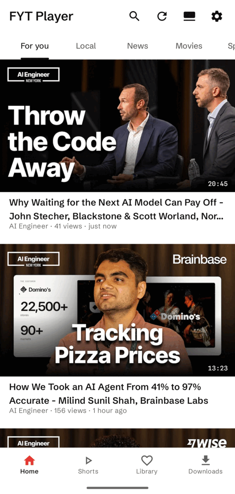
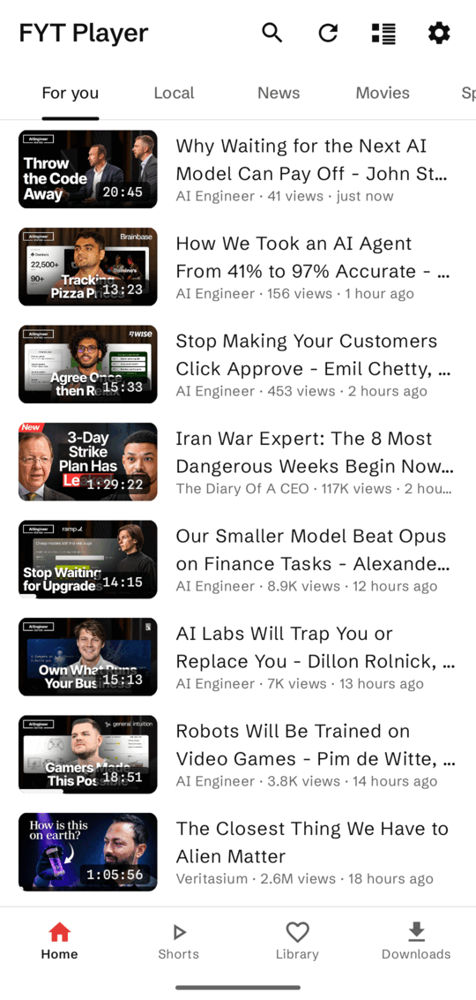
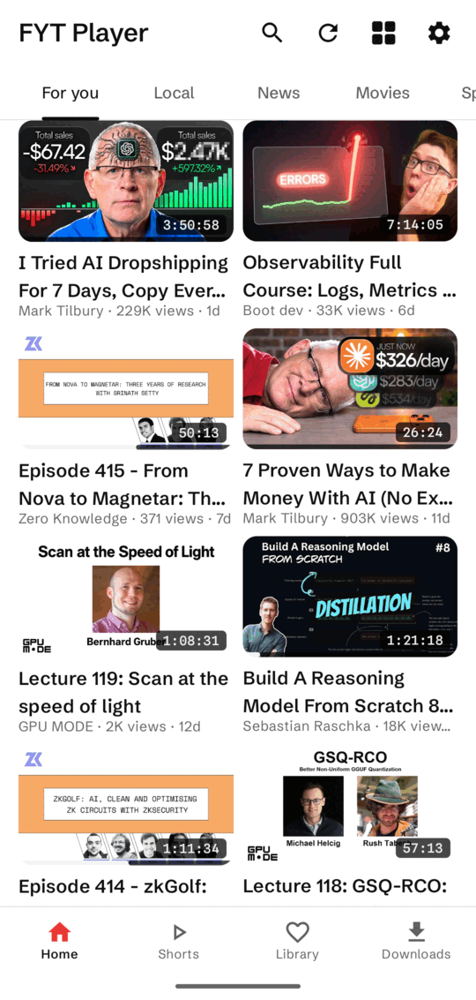
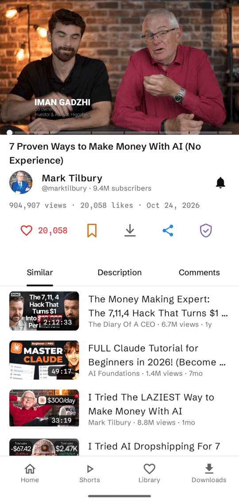
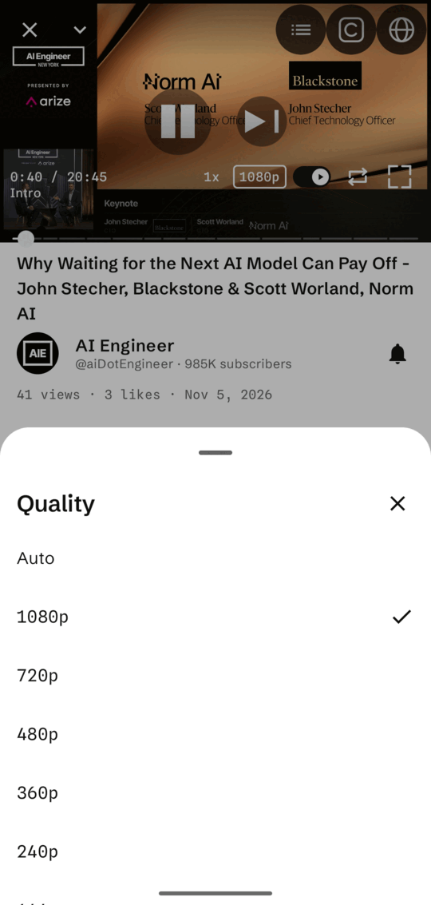
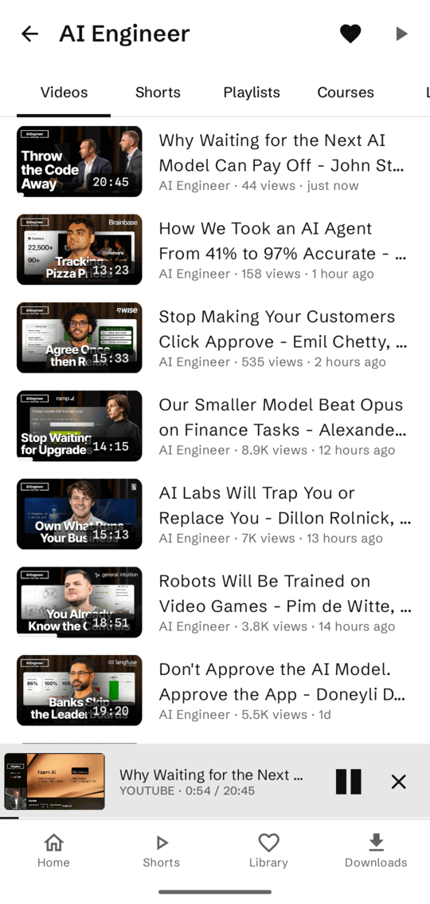
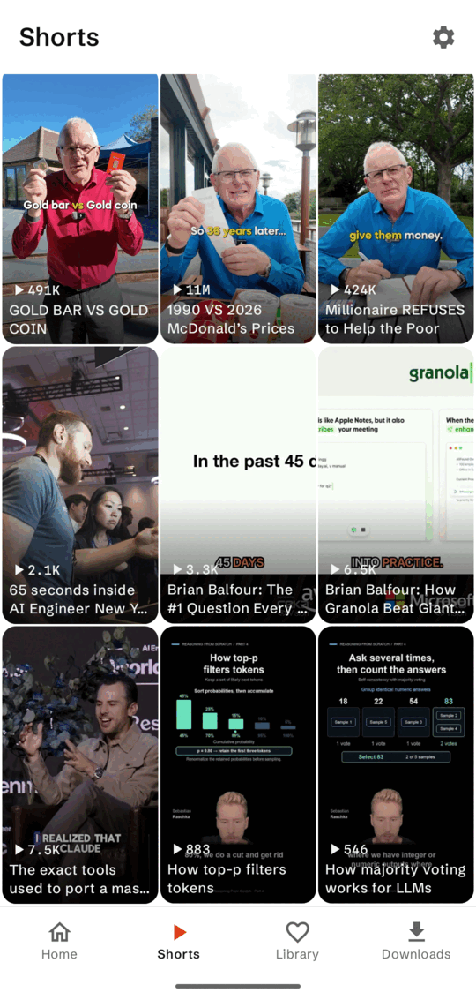
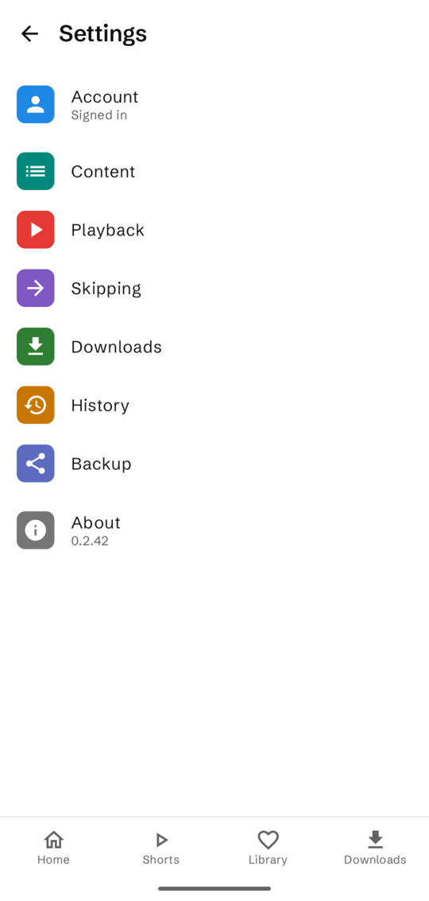

<p align="center">
  
</p>

<h1 align="center">FYT Player</h1>

<p align="center">
  Watch videos from YouTube, Facebook, X and TikTok on Android. Browse, play in the background, queue and download videos, with no ads or account needed.<br>
  <a href="https://github.com/shourovrm/fyt-player/releases/latest">Download the latest APK</a>
</p>

<p align="center">
  
  
  
  
</p>

<p align="center">
  
  
  
  
</p>

FYT Player is a free Android app for watching videos from YouTube, Facebook, X and TikTok in one place, without ads and without an account. You can keep a video playing with the screen off, queue several, and download them to watch offline.

It is installed from an APK file, not the Play Store. See [Install](#install).

## Features

**Browse and search**
- The Home feed shows new videos from your YouTube subscriptions. Subscribe to at least one channel to fill the feed.
- Search suggestions, channel pages with Videos, Shorts, Playlists and Live tabs, and a Subscribe button under the title bar.
- Playlists, comments and a Similar tab with YouTube recommendations, including a shorts shelf.
- Choose the content region and language in settings.
- Show the Home feed as full-width cards, a compact list or a two-column grid. Choose the default layout in settings or switch it next to search.
- A channel's Shorts tab uses a three-column portrait grid, like the main Shorts tab.

**Shorts**
- Swipe vertically through shorts from your subscribed channels.
- Channels with a short posted in the last 3 days appear first. Older channels follow in 3-day groups by posting date. Order within each group is random, and watched shorts go last.
- YouTube does not include upload dates in shorts listings. When the feed refreshes, FYT Player makes one extra request per channel to get the date of its newest short.

**Playback**
- Background playback with lock-screen, headset and Bluetooth controls.
- The player has controls for captions, speed, quality, loop and fullscreen, plus chapters and audio language. The same bar is used on the video page and in fullscreen.
- For videos with chapters, open the chapter list and tap a chapter to jump to it. The seek bar marks each chapter start and shows the current chapter title above it. The Description tab lists chapters once, without duplicate timestamp lines from the uploader.
- When a video has multiple audio tracks, choose one with the globe button. The original track is the default, and playback position is kept when switching.
- Play next, add to queue, reorder, shuffle and autoplay the next video. Autoplay follows the Similar list and skips shorts, like YouTube.
- Double-tap to seek, swipe to adjust brightness or volume, choose quality and preview with seek-bar thumbnails.
- Videos resume where you left off. List rows show a watched-progress bar for started videos; turn it off with the "Remember playback position" setting.
- SponsorBlock can skip segments. Use the shield in a video's action row to turn it off for that channel.
- A mini player stays on screen while you browse.
- Set separate default quality limits for Wi-Fi and mobile data.

**Library**
- History is grouped by day. Select multiple items in History, likes, channels and downloads to play or remove them; each page also has a play-all button.
- Keep watch history, likes, your playlists, followed YouTube playlists and subscriptions. Followed playlists use the same row style and show the first video as their cover.
- Share a followed playlist as a link or your own playlist as a list of video links. Share a YouTube playlist link into FYT Player to open it.
- Tap links, @handles and timestamps in video descriptions.
- Export playlists, likes and subscriptions to one HTML file, then import it on another device.

**Downloads**
- Download video or audio-only at a chosen quality, with file sizes shown. Queue multiple downloads, pause, resume or cancel them, and see speed, ETA and final size. A notification appears when a download finishes.
- Save subtitles as an .srt file from a video's long-press menu; English subtitles are preferred.
- Choose the download folder and file format.
- Downloaded videos play from their files, including offline. The quality menu offers "Stream instead", and the download menu has "Open with another app."

**Open shared links**
- Share a link from YouTube, Facebook, TikTok or X to FYT Player, or tap a link and choose FYT Player from the "Open with" list.
- Facebook videos open in the landscape player; TikTok clips open in the vertical pager.

## Platform support

| Platform | What works |
|---|---|
| YouTube | Browse, search, playback, library and download features described above. Optional sign-in for age-restricted and members-only content is currently not working. |
| Facebook | Play and download a video or reel from a shared link. There is no search or page browsing: Facebook offers no public listing API, and the upstream extractor is intermittent on some videos. |
| TikTok | Works only some of the time. A shared clip plays in the vertical pager, with no search or feed. TikTok blocks by IP address: in a test on 2026-10-28, 2 of 6 sample links played and the other 4 were refused as "IP address is blocked". After a batch of clips it also answers 403 for a while. The app shows a refused clip as unavailable. |
| X / Twitter | Probably does not work now. X keeps closing anonymous access, so a shared link may show as unavailable. In a desktop yt-dlp test on 2026-10-28, public posts with video still played, but this release has not been tested on a phone. |

## When a site blocks a video

If a site requires a login, CAPTCHA, payment, location access or age check, or blocks a video with DRM or a rate limit, FYT Player shows that state and stops. It does not retry in a loop, forge requests or rebuild signatures.

## Install

The app needs Android 8.0 or newer. Each release has one APK per processor type:

| APK | For |
|---|---|
| `arm64-v8a` | Almost every phone made since 2017. Pick this one if unsure. |
| `armeabi-v7a` | Older or low-cost phones with a 32-bit processor. |
| `x86_64` | Emulators and some Chromebooks. |

If the `arm64-v8a` APK says "App not installed", try `armeabi-v7a`.

1. Download the APK from the [latest release](https://github.com/shourovrm/fyt-player/releases/latest).
2. Open it on the phone and allow installs from that source if asked.
3. Updates install over the previous version. Your library, settings and downloads are kept.

## Privacy

- The app has no analytics, telemetry or crash upload. It keeps the last crash locally in Settings so you can paste it into a bug report.
- Only canonical page URLs are stored. Signed or tokenised media and thumbnail URLs stay in memory and are never written to the database, an export file or a log.
- Cookies are isolated per site. Signing in to YouTube does not expose that session to any other platform.
- App data stays in the app's own directory and is removed when you uninstall. Library exports are plain HTML files you can open and read.

## Build from source

The build needs JDK 21 and an Android SDK with platform 36 and build-tools 36. The extractor library is included in `third_party/`, so no other checkout is needed.

```sh
git clone https://github.com/shourovrm/fyt-player.git
cd fyt-player
```

Release builds are signed using a `keystore.properties` file in the repo root, which is gitignored. Create your own keystore and point the file at it:

```properties
storeFile=my-release.jks
storePassword=...
keyAlias=...
keyPassword=...
```

Then build and install:

```sh
./gradlew assembleRelease
adb install -r app/build/outputs/apk/release/app-arm64-v8a-release.apk
```

Run the unit tests with `./gradlew testReleaseUnitTest`. They use saved fixtures and never touch the network.

## Structure

```
ui/            screens and the one app shell (scaffold, nav, mini player)
player/        PlaybackSession, media service, controls, chapters, audio tracks
source/        one module per platform behind the VideoSource interface
engine/        stream resolver chain
core/          contracts: VideoRef, VideoDetail, MediaFormat, ...
data/          Room database, DataStore settings, backup codec
third_party/   vendored PipePipeExtractor and its patches
```

YouTube metadata and streams come from [PipePipeExtractor](https://github.com/InfinityLoop1308/PipePipeExtractor), a NewPipeExtractor fork. Its source is included in `third_party/PipePipeExtractor` at upstream v5.5.0 with three small patches: shorts shelves in search results, the related-videos sidebar, and the channel @handle on the video page. The patches are in `third_party/patches/`; `third_party/README.md` explains how to move to a newer upstream tag.

Other platforms, YouTube downloads and the sign-in path use [yt-dlp](https://github.com/yt-dlp/yt-dlp) on the device through [youtubedl-android](https://github.com/yausername/youtubedl-android). yt-dlp can be updated from Settings without a new APK.

Extraction code stays out of the UI, and media URLs only come from the resolver chain. A screen sees a page URL and a title, not a selector or a signed stream URL.

## License

The source in this repository is [MIT](LICENSE), except `third_party/PipePipeExtractor`, which keeps its own GPL-3.0 license.

The release APK contains PipePipeExtractor (GPL-3.0) and [yt-dlp](https://github.com/yt-dlp/yt-dlp) (Unlicense), so the built app as a whole is distributed under the terms of the GPL-3.0.

The screenshots show public YouTube pages. The videos, thumbnails and channel names in them belong to their owners.
