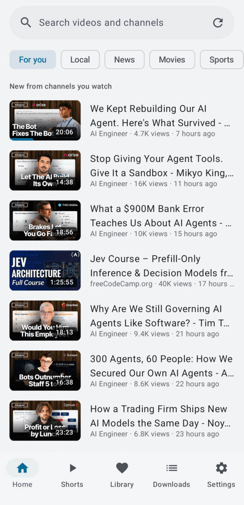
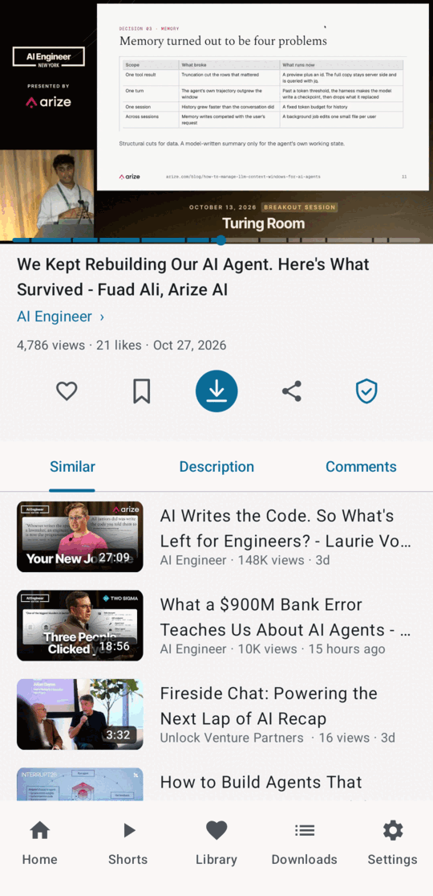
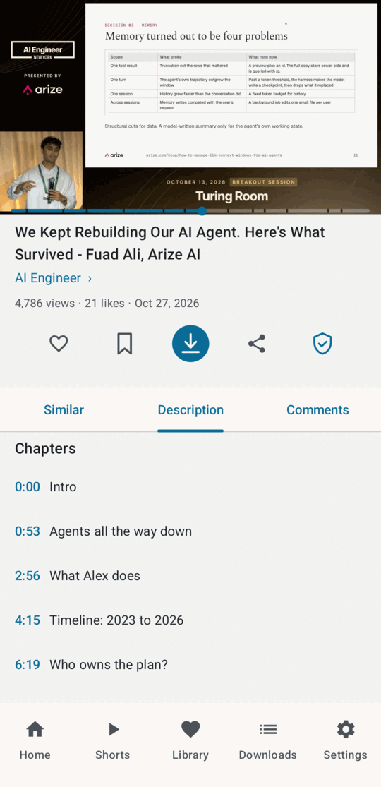
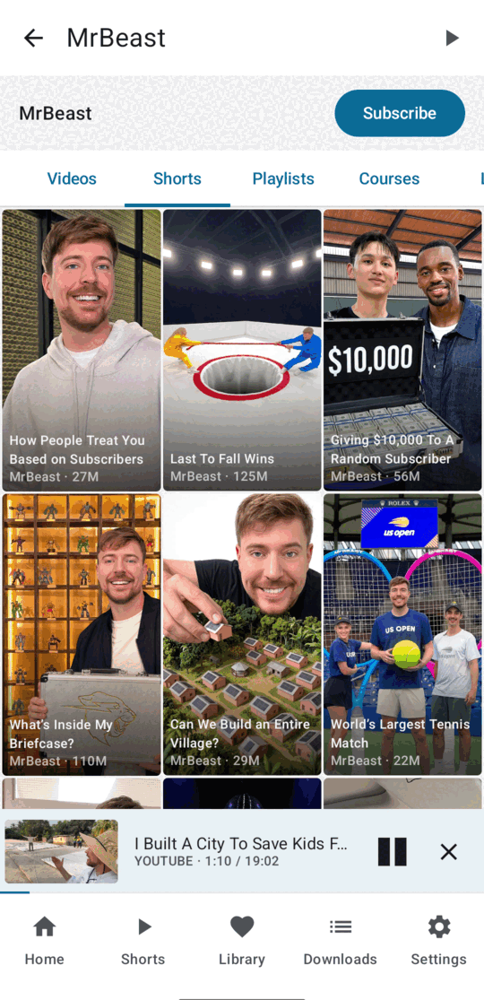

<p align="center">
  
</p>

<h1 align="center">FYT Player</h1>

<p align="center">
  Android video player for YouTube, Facebook, Twitter/X and TikTok.<br>
  Browse, play in the background, queue and download. No ads, no account needed.<br>
  <a href="https://github.com/shourovrm/fyt-player/releases/latest">Download the latest APK</a>
</p>

<p align="center">
  
  
  
  
</p>

FYT Player is a single-Activity app written in Kotlin with Jetpack Compose. It opens YouTube
videos, shorts, channels and playlists, plays shared links from Facebook, TikTok and X, and keeps
playing with the screen off. It is distributed as a sideloaded APK; there is no Play Store listing.

## Features

**Browse and search**
- The Home feed lists new videos from your subscriptions. Subscribe to at least one channel, or
  "For you" stays empty.
- Search has suggestions. Channel pages have Videos, Shorts, Playlists and Live tabs, and a
  Subscribe button in a row under the title bar.
- A channel's Shorts tab is a three-column portrait grid, the same tile as the main Shorts tab.
- Playlists, comments, and a "Similar" tab with YouTube's own recommendations for the video
  (including its shorts shelf).
- Content region and language are settings, not whatever the server guesses.

**Shorts**
- The Shorts tab is a vertical swipe pager over the shorts of your subscribed channels.
- A channel that posted a short in the last 3 days comes first. Older channels follow in 3-day
  groups by how recently they posted. Inside each group the order is random, and shorts you have
  already watched go last.
- YouTube gives no upload date in a shorts listing, so the app reads the date of each channel's
  newest short with one extra request per channel when the feed refreshes.

**Playback**
- Background playback with lock-screen, headset and Bluetooth controls.
- The player bar is icon-only: captions, speed, quality, loop and fullscreen at the bottom,
  chapters and audio language at the top right. Page view and fullscreen use the same bar.
- Chapters: when a video has chapters, a button opens the list and a tap jumps to that chapter.
  The seek bar shows a notch at each chapter start and the current chapter title above it. The
  Description tab lists the chapters once, without the uploader's duplicate timestamp lines.
- Audio language: when YouTube offers more than one audio track for a video, a globe button opens
  a picker. The original track stays the default and the position is kept when you switch.
- Queue: play next, add to queue, reorder, shuffle, autoplay next (autoplay follows the Similar
  list and skips shorts, like YouTube).
- Double-tap seek, swipe for brightness and volume, quality picker, seek-bar thumbnails.
- Resumes where you left off. Every list row shows a thin watched-progress bar for videos you have
  started (off when "Remember playback position" is off).
- SponsorBlock segment skipping is optional. A shield button in the video's action row turns it
  off for one channel.
- A mini player stays on screen while you keep browsing.
- Separate default quality caps for Wi-Fi and mobile data.

**Library**
- Watch history, likes, your own playlists, followed YouTube playlists (same row style, first
  video as cover) and subscriptions.
- Share a playlist out as a link (followed) or as a list of video links (your own). Share a YouTube
  playlist link into the app to open it.
- Video description links, @handles and timestamps are tappable.
- Export playlists, likes and subscriptions to one HTML file and import it on another device.

**Downloads**
- Pick video or audio-only and a quality (file sizes shown), queue several, pause, resume and
  cancel. The list shows speed, ETA and final size, and a notification appears when each finishes.
- "Download subtitles" in a video's long-press menu saves an .srt (English preferred).
- Choose the download folder and file format.

**Sharing in**
- Share a link from YouTube, Facebook, TikTok or X to FYT Player, or tap a link and choose it from
  the "Open with" list. Facebook videos open in the landscape player and TikTok clips in the
  vertical pager.

## Platform support

| Platform | What works |
|---|---|
| YouTube | Everything above. Optional sign-in for age-restricted and members-only content (currently not working). |
| Facebook | Play and download a video or reel from a shared link. No search and no page browsing: Facebook offers no public listing API, and the upstream extractor is intermittent on some videos. |
| TikTok | Play a clip from a shared link in the vertical pager. No search and no feed. TikTok rate-limits by IP; after a batch of clips it answers 403 for a while, and the app shows that as unavailable. |
| X / Twitter | Play a video from a shared link. |

## What it refuses to do

When a site puts up a wall (login, CAPTCHA, paywall, geo-block, age gate, DRM or rate limit), the
app shows that state and stops. It does not retry in a loop, forge requests or rebuild signatures.

## Install

The app needs Android 8.0 or newer on a 64-bit ARM device, which covers almost every phone since
2017.

1. Download the APK from the [latest release](https://github.com/shourovrm/fyt-player/releases/latest).
2. Open it on the phone and allow installs from that source if asked.
3. Updates install over the previous version. Your library, settings and downloads are kept.

## Build from source

The build needs JDK 21 and an Android SDK with platform 36 and build-tools 36. The extractor
library is vendored in `third_party/`, so no other checkout is needed.

```sh
git clone https://github.com/shourovrm/fyt-player.git
cd fyt-player
```

Release builds are signed from a `keystore.properties` in the repo root, which is gitignored.
Create your own keystore and point the file at it:

```properties
storeFile=my-release.jks
storePassword=...
keyAlias=...
keyPassword=...
```

Then build and install:

```sh
./gradlew assembleRelease
adb install -r app/build/outputs/apk/release/app-release.apk
```

Run the unit tests with `./gradlew testReleaseUnitTest`. They use saved fixtures and never touch
the network.

## Structure

```
ui/            screens and the one app shell (scaffold, nav, mini player)
player/        PlaybackSession, media service, controls, chapters, audio tracks
source/        one module per platform behind the VideoSource interface
engine/        stream resolver chain
core/          contracts: VideoRef, VideoDetail, MediaFormat, ...
data/          Room database, DataStore settings, backup codec
third_party/   vendored PipePipeExtractor and its patches
```

YouTube metadata and streams come from
[PipePipeExtractor](https://github.com/InfinityLoop1308/PipePipeExtractor), a NewPipeExtractor fork.
Its source is vendored in `third_party/PipePipeExtractor` at upstream v5.2.5 plus two small patches
(shorts shelves in search results and in the related-videos sidebar). The patches are kept as files
in `third_party/patches/`, and `third_party/README.md` describes how to move to a newer upstream
tag. The other platforms, plus YouTube downloads and the sign-in path, go through
[yt-dlp](https://github.com/yt-dlp/yt-dlp) running on the device via
[youtubedl-android](https://github.com/yausername/youtubedl-android). yt-dlp can be updated from
Settings without a new APK.

Two rules run through the codebase. Extraction code never lives in UI, and media URLs only come
out of the resolver chain. A screen sees a page URL and a title, never a selector or a signed
stream URL.

## Privacy

- There is no analytics, telemetry or crash upload. The last crash is kept locally and shown in
  Settings so you can paste it into a bug report yourself.
- Only canonical page URLs are stored. Signed or tokenised media and thumbnail URLs stay in memory
  and are never written to the database, an export file or a log.
- Cookies are isolated per site. Signing in to YouTube does not expose that session to any other
  platform.
- Everything the app stores lives in its own app directory and leaves with an uninstall. The
  library export is a plain HTML file you can open and read.

## License

The source in this repository is [MIT](LICENSE), except `third_party/PipePipeExtractor`, which
keeps its own GPL-3.0 license.

The release APK contains PipePipeExtractor (GPL-3.0) and [yt-dlp](https://github.com/yt-dlp/yt-dlp)
(Unlicense), so the built app as a whole is distributed under the terms of the GPL-3.0.

The screenshots show public YouTube pages. The videos, thumbnails and channel names in them belong
to their owners.
